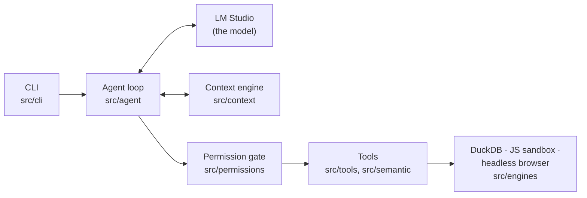
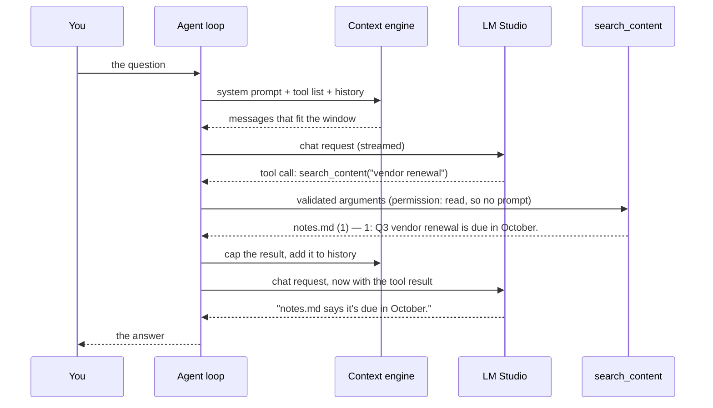
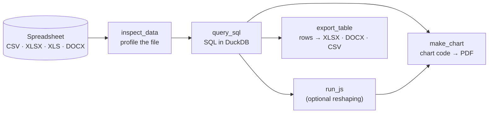

# How clankr works

clankr is a TypeScript program (Node 24) that turns a small local model into an agent that can work with your files. The model runs in LM Studio; clankr runs everything else: it decides what the model sees, executes the tools the model asks for, checks permissions, and keeps the conversation inside the model's context window.

This document walks through one request from start to finish, then looks at the parts that do the heavy lifting: the agent loop, context management, and the data pipeline with DuckDB. File paths point at the code; the reasons behind each design choice are in [PRD.md](../PRD.md) and [specs/](../specs/README.md).

## The parts



| Part | Job |
|---|---|
| **CLI** | The REPL and `clankr -p` one-shot mode. Draws the live activity line, tool lines, and approval prompts. |
| **Agent loop** | Runs one *turn*: sends the conversation to the model, executes the tool calls it gets back, repeats until the model answers. |
| **Context engine** | Counts tokens, stores large tool results on disk, and shrinks old history so every request fits the window. |
| **LM Studio client** | Talks to LM Studio on `localhost:1234`: lists and loads models, streams chat replies, counts tokens. |
| **Permission gate** | Decides whether a tool call may run, may run after asking you, or is refused. |
| **Tools** | 19 tools: search, read, edit and move files, view images, inspect and query data, draw charts, export tables, delegate a subtask. |
| **Engines** | DuckDB for SQL, a V8 isolate for model-written JavaScript, and an offline Chromium that draws charts. |

clankr's only network connection is to LM Studio on your own machine.

## One request, start to finish

You type *"Which file mentions the vendor renewal?"* in a folder that contains `notes.md`.



What happens at each step:

1. **Your message is added to the session history.** The history is a list of chat messages (user, assistant, tool results) saved to `~/.clankr/sessions/<id>/transcript.jsonl` so `clankr --resume` can reopen it.
2. **The round is planned** (`src/agent/round-plan.ts`). clankr picks which tools to offer. The core file tools are always there; image tools only if the model can see images; data tools only once a data file appears in the conversation. It also builds the system prompt: a short base prompt plus *reference text* that is loaded only when relevant, such as the Vega-Lite chart guide when you ask for a chart.
3. **The context engine prepares the request** (`prepareMessages`). It counts tokens and, if the request would be too large, shrinks old history first (see [Context management](#context-management)).
4. **The model streams its reply** through LM Studio's OpenAI-compatible `/v1/chat/completions`. The reply can contain reasoning, answer text, and tool calls. Reasoning is shown as one dim line and never saved.
5. **Each tool call is checked and run** (`src/agent/tool-execution.ts`):
   - the arguments are repaired where safe (a number sent as a string, JSON sent as a string) and validated against the tool's schema; a bad call gets a short corrective error naming the field;
   - the permission gate decides; for changes, the tool first builds a *preview* (a diff, a list of paths, the SQL to run) that the gate shows you;
   - the tool runs and returns its full output.
6. **The result is capped.** Each tool has a token budget (800 by default). Bigger output is saved to disk and the model gets the start and end plus a short *handle* it can page through with `read_result`.
7. **Repeat** until the model replies without a tool call. That reply is the answer.

## The agent loop

The loop in `src/agent/turn.ts` looks like this:

```ts
history.push(userMessage)
for (round = 1; ; round++) {
  plan     = planRound()                            // tools, system prompt, references
  messages = context.prepareMessages(plan, history) // guaranteed to fit
  reply    = streamFromModel(messages)              // text, reasoning, tool calls
  history.push(reply)
  if (reply has no tool calls) return "done"

  for (call of reply.toolCalls) {
    result = validate(call) ?? gate(call) ?? run(call)
    history.push(context.capResult(result))
  }
  if (round == 20 || 3 wasted calls in a row) return "limit"
}
```

Details worth knowing:

- **Two tool-calling styles.** Models trained for tool use get native tool calls. Others are told to write `<tool_call>{"name": …, "arguments": …}</tool_call>` in their text, which the loop parses.
- **Wasted calls.** An invalid call, or one the gate already refused earlier in the turn, counts as wasted. A refused call is answered from memory without asking the gate again; a small model otherwise retries it in a loop.
- **Cancellation.** Ctrl+C aborts the HTTP stream and the running tool; every pending tool call still gets an answer so the history stays valid.
- **Sub-agents.** The `delegate` tool runs a fresh, read-only copy of this loop on a subtask and returns only a short summary.

## Context management

The target model runs with a 16,384-token window, shared like this:

| Share | Tokens | Used for |
|---|---|---|
| 10% | 1,638 | System prompt and tool definitions |
| 45% | 7,373 | Conversation history |
| 20% | 3,277 | Current tool results |
| 25% | 4,096 | Reserved for the model's reply |

Three techniques keep each request inside it:

**1. Large results go to disk.** A tool result over its budget is stored, and the model sees something like:

```
[Output too long (1,204 lines, about 9,800 tokens), stored as r7. Showing the start and end. Use read_result with handle r7 to page or search it.]
...first lines...
...last lines...
```

**2. Old results are replaced by stubs.** After 3 turns, a tool result becomes one line that still points to the stored copy:

```
[Evicted old result of query_sql {"sql":"SELECT place, year, SUM(…)"} to save context. Full output: r2 (read_result).]
```

**3. Old turns are summarised.** When the request passes 70% of the window, older turns are replaced by a note with four parts: *goal*, *facts found*, *files touched*, *open steps*. Handles in the note still work.

Token counts come from LM Studio: before a request from its tokenizer, after it from the `usage` it reports. The status line shows the latest count.

## Questions about data

Data questions use four tools in a row. The model never sees the whole file: it sees a profile, then query results, then a confirmation that the chart was saved.



### 1. `inspect_data`: what's in the file

`src/tools/data/inspect` identifies the real format from the file's bytes, finds the header row, and profiles every column with DuckDB. This is the model's whole view of a 1.9-million-row file:

```
Table population_by_municipali (comma-separated): 1,925,184 rows x 8 columns, header row 1
column    | type   | nulls | distinct | min           | max        | samples
CSD Name  | text   | 0     | ~398     | Acadia No. 34 | Youngstown | Cypress County
Year      | number | 0     | ~26      | 2001          | 2025       | 2003; 2004; 2006
Age       | mixed (21156 of 1925184 values are not numbers; SQL sees text) | …
Value     | number | 0     | ~9287    | 0             | 14811      | 40; 42; 27
```

Real exports need extra handling, all found while testing on Government of Alberta open data:

- **Non-UTF-8 files.** DuckDB reads only UTF-8, so a Windows-1252 file is converted once into the session's scratch folder and DuckDB reads the copy.
- **Late type changes.** DuckDB guesses column types from the first ~20,000 rows. When a later value breaks the guess (`Age` becomes `90+` at row 86,452), the file is re-read with types guessed from every row.
- **Notes for the model.** The profile points out traps the model falls into: an ID column that repeats across rows ("count with `COUNT(DISTINCT …)`"), and what one row stands for in a time series ("one shelter per date; SUM per city and date first").

`.xls` sheets and `.docx` tables are converted to row sets (JSON Lines files) that DuckDB reads. Every inspected file is *registered* under a SQL table name, which is how `query_sql` finds it.

### 2. `query_sql`: DuckDB does the counting

The model writes SQL against the registered table names; DuckDB, embedded in clankr, runs it over the whole file. The model gets the first 20 rows and a handle for the rest:

```
50 rows, 3 columns. Full result: r2.
place   | year | pop
Airdrie | 2001 | 21641
Airdrie | 2002 | 23374
...
```

The SQL is written by a model, and files can contain text meant to trick it, so DuckDB is locked down in layers (`src/engines/duckdb`):

1. **Statement check.** DuckDB's own parser must find exactly one statement, and its prepared type must be `SELECT`. `INSERT`, `COPY`, `ATTACH`, `INSTALL`, `SET`, and two statements in one call are all refused.
2. **File access.** Only the registered files can be opened:
   ```sql
   SET allowed_paths = ['/Users/you/data/population.csv'];
   SET enable_external_access = false;
   ```
   A path or URL in the SQL (`read_csv('/etc/hosts')`) is refused.
3. **No extensions.** Install and autoload are off; the Excel reader is loaded from `vendor/` by path before locking.
4. **Locked.** `SET lock_configuration = true`, so no query can undo the above.

The configuration alone would not stop `COPY … TO` or `CREATE TABLE`; the statement check does, which is why both layers exist. One locked DuckDB instance serves the session, with each table as a view over its file. Because a locked instance can't be given new files, registering another file rebuilds it (10–20 ms). A query that runs past its time limit is stopped with DuckDB's `interrupt()`, and large intermediate results spill to the session's scratch folder.

### 3. `run_js`: reshaping in a sandbox

When SQL isn't convenient, the model can write JavaScript. It runs in a V8 isolate (`isolated-vm`) with no `require`, `process`, `fetch`, or file access, and a 5-second, 128 MB limit. It reaches data only through `data("r2")` (read a stored row set) and `save(name, rows)` (store one).

### 4. `make_chart`: from chart code to PDF

The model writes chart code that calls `render(spec, rows, summary)` with a [Vega-Lite](https://vega.github.io/vega-lite/) spec. clankr then:

1. runs the code in the same sandbox and captures what was passed to `render` (up to 6 charts);
2. checks each spec: row limit, Vega-Lite schema, every field is a real column; and removes any colours or fonts the model set, because the user's theme controls styling;
3. fixes common mistakes from the data itself: years drawn as `2000` not `2,000`, large numbers as `24B`, months in time order (a fiscal year from April), empty categories labelled `(no month)`, overlapping line labels pushed apart;
4. draws it in a headless Chromium page that contains only Vega-Lite and the data, with every network request blocked;
5. writes the file next to the data (PDF by default, or PNG, SVG, DOCX, XLSX), plus the SQL, chart code, and spec so it can be rebuilt without the model. Several charts become one portrait PDF, one chart and its summary per page.

`export_table` writes a stored query result to an XLSX, DOCX, PDF, or CSV file the same way.

## Semantic search

`search_content` finds exact words. For "find the notes about our office move" when you don't know the wording, there is `search_meaning`. You choose which folders to index with `clankr index <folder>`; clankr splits files into passages of about 1,200 characters, gets an embedding for each from LM Studio (`/v1/embeddings`), and stores them in a DuckDB file per folder under `~/.clankr/index/`. The tool ranks passages by similarity to the question and returns the best ones with their file and line numbers.

## Permissions

| What the tool does | Default (`ask` mode) | `auto-edit` mode | `read-only` mode |
|---|---|---|---|
| Reads | runs | runs | runs |
| Changes files inside the allowed folders | asks | runs | refused |
| Changes files elsewhere | asks | asks | refused |
| Deletes (to the Trash) | asks | asks | refused |
| Runs SQL, JS, or charts on a data file | asks once per file | asks once per file | refused |

Some places are refused in every mode, for reading too: `~/.ssh`, keychains, browser profiles, credential files, and `~/.clankr` itself. Paths are resolved to their real location first, so a symbolic link can't sneak around the rule. In one-shot mode nothing can ask, so `--permission-mode auto-edit` and `--allow-data` grant those cases up front. Every call is written to `~/.clankr/logs/audit.jsonl`.

## A real run

The request: *"From population-by-municipality.csv, plot total population with 2001 set to 100 for Calgary, Airdrie, … grouped by metro area, with labels at the line ends instead of a legend."* Gemma 4 12B produced:

```
● inspect_data population-by-municipality.csv · 375 tokens · 5.2 s
● query_sql SELECT "CSD Name", "Year", SUM("Value") AS pop … · 411 tokens · 2.3 s
● query_sql WITH base_data AS ( SELECT "CSD Name", "Year", SUM("Value… · 715 tokens · 2.3 s
● make_chart · 177 tokens · 6.1 s
```

The second query did the real work in DuckDB: sum each town's population per year, divide by its 2001 value (`FIRST_VALUE(pop) OVER (PARTITION BY place ORDER BY year)`), and add a `metro` column with `CASE WHEN`. The chart code faceted by metro, drew a line per town and a text label at each line's last point. The model saw under 1,700 tokens of data in total; DuckDB read all 110 MB. The result: one panel per metro, with Chestermere at 722 and Airdrie at 428 (2001 = 100).

## Code map

| Folder | What it holds |
|---|---|
| `src/cli` | REPL, one-shot mode, slash commands, approval prompts, `clankr config` |
| `src/app` | Wires a session together: model connection, tools, storage |
| `src/agent` | The turn loop, tool registry, argument repair, system prompt |
| `src/context` | Token counting, result store, eviction, compaction, `read_result` |
| `src/lmstudio` | LM Studio client |
| `src/permissions` | Path rules, the permission gate, the audit log |
| `src/storage` | `~/.clankr`, sessions, `clankr wipe`, `--ephemeral` |
| `src/tools/search`, `src/tools/fs`, `src/tools/image` | File search, file changes, `view_image` |
| `src/tools/data`, `src/data` | `inspect_data`, `query_sql`, `run_js`, `make_chart`, `export_table` |
| `src/engines/duckdb`, `src/engines/isolate`, `src/engines/browser` | DuckDB, the JS sandbox, the chart browser |
| `src/chart`, `src/output` | Chart checks and polish; PDF, DOCX, and XLSX writers |
| `src/semantic` | `clankr index` and `search_meaning` |
| `src/subagent` | `delegate` |
| `src/contracts` | The shared types every part builds against |
